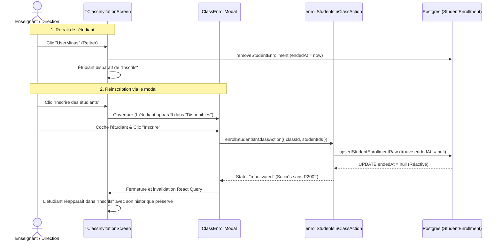

# Analyse Technique : Réactivation des Inscriptions Étudiants et Idempotence des Invitations

## 1. Contexte et Objectifs

### 1.1. Problématique Métier
Dans l'application Attendancy, un enseignant ou un membre de la direction doit pouvoir gérer la composition d'une classe depuis l'écran de gestion des participants ([`apps/web/src/components/users/list/TClassInvitationScreen.tsx`](../../apps/web/src/components/users/list/TClassInvitationScreen.tsx)) et son modal d'inscription ([`apps/web/src/components/personal/teacher/class/enrollment/ClassEnrollModal.tsx`](../../apps/web/src/components/personal/teacher/class/enrollment/ClassEnrollModal.tsx)).

Le cas d'usage fondamental est le suivant :
1. Un étudiant est inscrit dans une classe.
2. L'enseignant retire l'étudiant de la classe (par exemple suite à une erreur, un changement provisoire ou un départ temporaire).
3. L'enseignant souhaite ensuite **réinscrire** cet étudiant dans cette même classe via le modal.

### 1.2. Constat du Comportement Actuel (Dysfonctionnements)
* **Retrait réussi** : Le retrait fonctionne correctement et positionne une date de fin d'inscription (`endedAt = new Date()`) sur la ligne `StudentEnrollment`.
* **Réinscription impossible (Crash DB)** : Dès que l'étudiant retiré est sélectionné dans le modal pour être réinscrit, le système échoue lors de la création ou lors de l'acceptation de l'invitation avec une violation de contrainte d'unicité Postgres (`P2002`).
* **Absence d'idempotence** : Le pipeline d'acceptation d'invitation ([`apps/web/src/modules/auth/members/inbox-invitation.ts`](../../apps/web/src/modules/auth/members/inbox-invitation.ts)) et de complétion d'inscription ([`apps/web/src/modules/auth/members/complete-signup.ts`](../../apps/web/src/modules/auth/members/complete-signup.ts)) tente aveuglément de recréer l'entité `Student` et la relation `StudentEnrollment` avec `tx.*.create()`, provoquant des erreurs bloquantes pour tout utilisateur déjà connu de l'organisation.

### 1.3. Principes d'Architecture Retenus
1. **Séparation nette des responsabilités (Blocage 1)** :
   * L'écran parent ([`TClassInvitationScreen.tsx`](../../apps/web/src/components/users/list/TClassInvitationScreen.tsx)) gère les étudiants actuellement membres actifs et leur retrait.
   * Le modal ([`ClassEnrollModal.tsx`](../../apps/web/src/components/personal/teacher/class/enrollment/ClassEnrollModal.tsx)) est exclusivement dédié à l'**accueil et l'inscription** (vivier d'étudiants disponibles et adresses emails externes). Il ne doit pas surcharger sa responsabilité avec une interface de désinscription.
   * En revanche, le vivier d'étudiants disponibles du modal doit instantanément inclure tout étudiant retiré, et sa réinscription doit s'effectuer sans aucune friction technique.
2. **Fonction Upsert / Réactivation d'Enrollment (Blocage 2)** :
   * Implémenter une opération atomique `upsertStudentEnrollment` respectant l'historique d'assiduité (`Attendance`) sans recréer de doublon de clé `(studentId, classId)`.
3. **Idempotence stricte du cycle de vie utilisateur (Blocage 3)** :
   * Un utilisateur ou un étudiant existant ne doit en aucun cas être recréé. L'adhésion, le profil et l'inscription doivent être récupérés, réactivés ou créés selon leur état présent en base.

---

## 2. Cartographie de l'Existant et Fichiers Concernés

| Domaine / Couche | Fichier Source | Rôle Actuel | Anomalie Identifiée |
| :--- | :--- | :--- | :--- |
| **Schéma DB** | [`apps/web/prisma/schemas/academic.prisma`](../../apps/web/prisma/schemas/academic.prisma) | Modèle `StudentEnrollment` avec `@@unique([studentId, classId])` et champ `endedAt`. | La contrainte d'unicité couvre la table entière, interdisant deux lignes avec le même couple même si `endedAt != null`. |
| **Schéma DB** | [`apps/web/prisma/schemas/profile.prisma`](../../apps/web/prisma/schemas/profile.prisma) | Modèle `Student` avec `@@unique([userId, orgId])`. | Empêche la recréation d'un profil étudiant déjà rattaché à l'établissement. |
| **Service DB** | [`apps/web/src/services/student-enrollment/database/student-enrollment.mutations.ts`](../../apps/web/src/services/student-enrollment/database/student-enrollment.mutations.ts) | Mutations DB d'inscription, clôture (`removeStudentEnrollment`) et réouverture unitaire. | `createStudentEnrollmentRaw` fait un simple `create()`. Pas de fonction unitaire générique `upsert` exportée pour l'ensemble du monorepo. |
| **Service Actions** | [`apps/web/src/services/student-enrollment/actions/student-enrollment.mutations.ts`](../../apps/web/src/services/student-enrollment/actions/student-enrollment.mutations.ts) | Server Actions Next.js (`enrollStudentsInClassAction`, `removeStudentEnrollmentAction`). | `enrollStudentsInClassAction` exige `requiredRole: "DIRECTION"` sans `allowPersonalOrg: true`, bloquant les enseignants. |
| **Module Auth/Membres** | [`apps/web/src/modules/auth/members/utils.ts`](../../apps/web/src/modules/auth/members/utils.ts) | Fonctions `createRoleSpecificEntity` et `enrollStudentInClass`. | `tx.student.create()` et `tx.studentEnrollment.create()` bruts sans vérification d'existence préalable. |
| **Module Invitation** | [`apps/web/src/modules/auth/members/inbox-invitation.ts`](../../apps/web/src/modules/auth/members/inbox-invitation.ts) | Consommation d'invitations depuis l'Inbox de l'étudiant. | Échoue dès que le profil ou l'inscription existe déjà. |
| **Module Invitation** | [`apps/web/src/modules/auth/members/complete-signup.ts`](../../apps/web/src/modules/auth/members/complete-signup.ts) | Finalisation d'inscription par lien externe. | Échoue sur `userOrganization.create()` et `createRoleSpecificEntity` si l'utilisateur existe déjà. |
| **Hooks UI** | [`apps/web/src/hooks/data/student-enrollments/useAvailableStudents.ts`](../../apps/web/src/hooks/data/student-enrollments/useAvailableStudents.ts) | Vivier d'étudiants non inscrits pour le modal. | Filtre `excludeByIds(allStudents, activeEnrollments)`. Fonctionne correctement car les clôturés n'ont plus `endedAt: null`. |
| **Hooks UI** | [`apps/web/src/hooks/data/student-enrollments/useClassEnrollForm.ts`](../../apps/web/src/hooks/data/student-enrollments/useClassEnrollForm.ts) | État du formulaire d'inscription en masse. | Envoie tout le monde via `inviteStudentsBulk` plutôt que d'inscrire directement les élèves déjà membres de l'école. |

---

## 3. Analyse Détaillée des Causes Racines

### 3.1. Le Cycle de Clôture d'une Inscription (Soft Delete)
Dans [`apps/web/src/services/student-enrollment/database/student-enrollment.mutations.ts`](../../apps/web/src/services/student-enrollment/database/student-enrollment.mutations.ts#L67-L75) :
```typescript
function endStudentEnrollmentRaw(client: PrismaOrTx, studentEnrollmentId: string, orgId: string) {
  return tryConstraint(
    client.studentEnrollment.update({
      where: { id: studentEnrollmentId, student: { orgId } },
      data: { endedAt: new Date() },
      select: { id: true, classId: true },
    }),
  );
}
```
Lorsqu'un étudiant est retiré, sa ligne `StudentEnrollment` n'est pas effacée (le hard delete casserait la table `Attendance` en raison de la clause `Restrict`). La colonne `endedAt` est horodatée.
En base de données, la contrainte unique est définie par :
```prisma
@@unique([studentId, classId])
```
Par conséquent, **il ne peut jamais exister deux lignes avec le même couple `(studentId, classId)`**, même si l'une d'entre elles possède `endedAt != null`.

### 3.2. Le Crash lors de la Réinscription
Lorsque l'enseignant sélectionne à nouveau cet étudiant dans [`ClassEnrollModal.tsx`](../../apps/web/src/components/personal/teacher/class/enrollment/ClassEnrollModal.tsx) :
1. Le modal invoque `inviteStudentsBulk` qui génère une invitation en base.
2. L'étudiant accepte l'invitation dans son interface Inbox.
3. Le code serveur exécute [`apps/web/src/modules/auth/members/utils.ts#L213-L218`](../../apps/web/src/modules/auth/members/utils.ts#L213-L218) :
```typescript
// ❌ CODE ACTUEL DÉFAILLANT DANS utils.ts
export async function enrollStudentInClass(
  tx: Tx,
  studentId: string,
  enrollment?: import("@/types/invitation").EnrollmentDetails
): Promise<void> {
  if (!enrollment?.classId) return;

  const studentEnrollment = await tx.studentEnrollment.create({
    data: {
      studentId,
      classId: enrollment.classId,
    },
  });
  // ...
}
```
💥 **Résultat** : Prisma lève l'erreur :
`Unique constraint failed on the fields: (studentId, classId)` (code `P2002`).

### 3.3. Le Crash sur la Recréation du Profil Étudiant
Dans le même flux d'acceptation ([`inbox-invitation.ts#L148`](../../apps/web/src/modules/auth/members/inbox-invitation.ts#L148)) :
```typescript
// ❌ CODE ACTUEL DÉFAILLANT DANS utils.ts
export async function createRoleSpecificEntity(tx, userId, role, orgId, departmentId) {
  switch (role) {
    case "STUDENT":
      return await tx.student.create({
        data: {
          userId,
          orgId,
        },
      });
  }
}
```
💥 **Résultat** : Étant donné que `Student` possède `@@unique([userId, orgId])`, tout étudiant qui était déjà inscrit dans l'établissement déclenche une seconde erreur `P2002` lors de l'appel à `tx.student.create()`.

---

## 4. Proposition Technique et Code Cible

L'architecture proposée repose sur **4 piliers** :
1. Une fonction atomique `upsertStudentEnrollmentRaw` au niveau du service database.
2. La sécurisation idempotente des utilitaires d'adhésion (`createRoleSpecificEntity` et `enrollStudentInClass`).
3. L'ouverture des droits RBAC de l'action serveur d'inscription aux enseignants (`allowPersonalOrg: true`).
4. L'optimisation du hook de formulaire du modal pour inscrire/réactiver immédiatement les étudiants connus de l'école sans exiger un transit par email/notification inutile.

---

### Étape 1 : Fonction Atomique `upsertStudentEnrollmentRaw` dans le Service Database

Fichier cible : [`apps/web/src/services/student-enrollment/database/student-enrollment.mutations.ts`](../../apps/web/src/services/student-enrollment/database/student-enrollment.mutations.ts)

Cette fonction vérifie l'existence préalable d'une inscription pour le couple `(studentId, classId)` :
* Si elle existe avec `endedAt !== null`, elle la **rouvre** (`endedAt = null`).
* Si elle existe déjà active (`endedAt === null`), elle n'altère rien et signale le statut `already_active`.
* Si elle n'existe pas, elle la **crée**.
* Si des sous-groupes (`groupIds`) sont fournis, ils sont attachés avec déduplication (`skipDuplicates: true`).

```typescript
// Code proposé pour apps/web/src/services/student-enrollment/database/student-enrollment.mutations.ts

export type UpsertEnrollmentStatus = "created" | "reactivated" | "already_active";

export interface UpsertEnrollmentResult {
  enrollmentId: string;
  status: UpsertEnrollmentStatus;
  classId: string;
}

/**
 * Insère ou réactive une inscription d'étudiant dans une classe de manière idempotente.
 * Préserve l'historique d'assiduité (Attendance) en rouvrant une ligne clôturée (endedAt = null)
 * sans enfreindre la contrainte d'unicité @@unique([studentId, classId]).
 */
export async function upsertStudentEnrollmentRaw(
  client: PrismaOrTx,
  params: {
    studentId: string;
    classId: string;
    orgId: string;
    groupIds?: readonly string[];
  }
): Promise<UpsertEnrollmentResult> {
  const { studentId, classId, orgId, groupIds } = params;

  // 1. Recherche d'une inscription préexistante (active ou clôturée)
  const existing = await client.studentEnrollment.findUnique({
    where: {
      studentId_classId: { studentId, classId },
    },
    select: {
      id: true,
      endedAt: true,
    },
  });

  let enrollmentId: string;
  let status: UpsertEnrollmentStatus;

  if (existing) {
    enrollmentId = existing.id;
    if (existing.endedAt !== null) {
      // Réactivation de l'inscription clôturée
      await tryConstraint(
        client.studentEnrollment.update({
          where: { id: existing.id, student: { orgId } },
          data: { endedAt: null },
          select: { id: true },
        })
      );
      status = "reactivated";
    } else {
      status = "already_active";
    }
  } else {
    // Création d'une nouvelle inscription
    const created = await tryConstraint(
      client.studentEnrollment.create({
        data: { studentId, classId },
        select: { id: true },
      })
    );
    enrollmentId = created.id;
    status = "created";
  }

  // 2. Affectation idempotente aux sous-groupes TD/TP éventuels
  if (groupIds && groupIds.length > 0) {
    await client.studentGroup.createMany({
      data: groupIds.map((groupId) => ({
        enrollmentId,
        groupId,
      })),
      skipDuplicates: true,
    });
  }

  return { enrollmentId, status, classId };
}
```

---

### Étape 2 : Idempotence des Utilitaires Métier Auth / Membres

Fichier cible : [`apps/web/src/modules/auth/members/utils.ts`](../../apps/web/src/modules/auth/members/utils.ts)

#### A. Rendre `createRoleSpecificEntity` idempotent
On remplace le simple `tx.student.create()` par une vérification d'existence basée sur l'index unique `userId_orgId`. Si le profil existe mais a été marqué supprimé (`deletedAt !== null`), on le réactive.

```typescript
// Code proposé pour apps/web/src/modules/auth/members/utils.ts

export async function createRoleSpecificEntity(
  tx: Omit<PrismaClient, "$connect" | "$disconnect" | "$on" | "$transaction" | "$use" | "$extends">,
  userId: string,
  role: Role,
  orgId: string,
  departmentId?: string | null
) {
  switch (role) {
    case "TEACHER": {
      const existing = await tx.teacher.findUnique({
        where: { userId_orgId: { userId, orgId } },
      });
      if (existing) {
        if (existing.deletedAt !== null) {
          return await tx.teacher.update({
            where: { id: existing.id },
            data: { deletedAt: null, departmentId: departmentId || undefined },
          });
        }
        return existing;
      }
      return await tx.teacher.create({
        data: {
          userId,
          orgId,
          departmentId: departmentId || undefined,
        },
      });
    }

    case "STUDENT": {
      // ✅ VÉRIFICATION IDEMPOTENTE : Si l'étudiant existe déjà dans l'org, on le retourne
      const existing = await tx.student.findUnique({
        where: { userId_orgId: { userId, orgId } },
      });
      if (existing) {
        if (existing.deletedAt !== null) {
          return await tx.student.update({
            where: { id: existing.id },
            data: { deletedAt: null },
          });
        }
        return existing;
      }
      return await tx.student.create({
        data: {
          userId,
          orgId,
        },
      });
    }

    case "PARENT": {
      const existing = await tx.parent.findUnique({
        where: { userId_orgId: { userId, orgId } },
      });
      if (existing) {
        if (existing.deletedAt !== null) {
          return await tx.parent.update({
            where: { id: existing.id },
            data: { deletedAt: null },
          });
        }
        return existing;
      }
      return await tx.parent.create({
        data: {
          userId,
          orgId,
        },
      });
    }

    case "DIRECTION": {
      const existing = await tx.direction.findFirst({
        where: { userId, orgId },
      });
      if (existing) return existing;
      return await tx.direction.create({
        data: {
          userId,
          orgId,
        },
      });
    }

    default:
      console.warn(`Rôle non géré: ${role}. Aucune entité spécifique créée.`);
      return null;
  }
}
```

#### B. Rendre `enrollStudentInClass` idempotent
Au lieu d'exécuter `tx.studentEnrollment.create()` qui provoque l'erreur `P2002`, on applique la logique de réactivation :

```typescript
// Code proposé pour apps/web/src/modules/auth/members/utils.ts

export async function enrollStudentInClass(
  tx: Tx,
  studentId: string,
  enrollment?: import("@/types/invitation").EnrollmentDetails
): Promise<void> {
  if (!enrollment?.classId) return;

  const { classId, groupIds } = enrollment;

  // 1. Recherche d'une inscription existante
  const existing = await tx.studentEnrollment.findUnique({
    where: {
      studentId_classId: { studentId, classId },
    },
    select: { id: true, endedAt: true },
  });

  let enrollmentId: string;

  if (existing) {
    enrollmentId = existing.id;
    // Si l'inscription était clôturée (retirée auparavant), on la réactive
    if (existing.endedAt !== null) {
      await tx.studentEnrollment.update({
        where: { id: existing.id },
        data: { endedAt: null },
      });
    }
  } else {
    // Nouvelle inscription
    const created = await tx.studentEnrollment.create({
      data: {
        studentId,
        classId,
      },
      select: { id: true },
    });
    enrollmentId = created.id;
  }

  // 2. Rattachement aux sous-groupes TD/TP sans doublon
  if (Array.isArray(groupIds) && groupIds.length > 0) {
    await tx.studentGroup.createMany({
      data: groupIds.map((groupId) => ({
        enrollmentId,
        groupId,
      })),
      skipDuplicates: true,
    });
  }
}
```

---

### Étape 3 : Ajustement des Permissions de la Server Action

Fichier cible : [`apps/web/src/services/student-enrollment/actions/student-enrollment.mutations.ts`](../../apps/web/src/services/student-enrollment/actions/student-enrollment.mutations.ts)

Actuellement, [`removeStudentEnrollmentAction`](../../apps/web/src/services/student-enrollment/actions/student-enrollment.mutations.ts#L43) permet le rôle personnel de l'enseignant (`allowPersonalOrg: true`), mais [`enrollStudentsInClassAction`](../../apps/web/src/services/student-enrollment/actions/student-enrollment.mutations.ts#L120) est restreint à la Direction :
```typescript
// Code actuel dans student-enrollment.mutations.ts
export async function enrollStudentsInClassAction(input: EnrollStudentsInClassInput) {
  const auth = await authAccess({ requiredRole: "DIRECTION" }); // ❌ Bloque TEACHER
```

**Correction proposée** :
```typescript
// Code proposé pour apps/web/src/services/student-enrollment/actions/student-enrollment.mutations.ts

export async function enrollStudentsInClassAction(input: EnrollStudentsInClassInput) {
  // ✅ Permet à la fois à la Direction et aux Enseignants en espace personnel d'inscrire/réinscrire
  const auth = await authAccess({
    requiredRole: "DIRECTION",
    allowPersonalOrg: true,
  });
  if (!auth.data) return { error: auth.error };
  const { user, orgId } = auth.data;

  const parsed = v.safeParse(enrollStudentsInClassSchema, input);
  if (!parsed.success) {
    return { error: parsed.issues[0]?.message ?? "Données invalides" };
  }

  try {
    const results = await enrollStudentsInClass(parsed.output, orgId);
    logAuditAsync({
      userId: user.id,
      orgId,
      action: "CREATE",
      resource: "STUDENT_ENROLLMENT",
      resourceId: parsed.output.classId,
      actor: { name: user.name, email: user.email },
    });
    return { data: results };
  } catch (error) {
    return { error: error instanceof Error ? error.message : ERRORS.SERVER };
  }
}
```

---

### Étape 4 : Optimisation du Flux dans le Hook de Formulaire UI

Fichier cible : [`apps/web/src/hooks/data/student-enrollments/useClassEnrollForm.ts`](../../apps/web/src/hooks/data/student-enrollments/useClassEnrollForm.ts)

Actuellement, `useClassEnrollForm` regroupe les étudiants de l'établissement et les nouveaux emails dans un seul appel `inviteStudentsBulk.mutateAsync()`.
Pour les étudiants déjà membres de l'école :
* Ils ont déjà leur compte actif.
* Les faire attendre un email ou une notification inbox pour une classe dans laquelle leur enseignant les réinscrit crée de la friction.

**Stratégie hybride optimale** :
1. Les étudiants sélectionnés depuis le vivier de l'école (`available`) sont inscrits/réactivés **immédiatement** via `enrollStudentsInClassAction`.
2. Les adresses emails libres saisies (`newEmails`) reçoivent une invitation via `inviteStudentsBulk`.
3. Les caches React Query (`STUDENT_ENROLLMENTS` et `INVITATIONS`) sont invalidés conjointement.

```typescript
// Évolution proposée dans useClassEnrollForm.ts (Extrait de la méthode submit)

const submit = async () => {
  if (totalCount === 0) return;

  const selectedStudentIds = selectedStudents.map((s) => s.id);
  const externalEmails = newEmails;

  try {
    const promises: Promise<unknown>[] = [];

    // 1. Inscription / Réactivation directe et immédiate des étudiants de l'établissement
    if (selectedStudentIds.length > 0) {
      promises.push(
        enrollStudentsInClassAction({
          classId,
          studentIds: selectedStudentIds,
        })
      );
    }

    // 2. Invitation par email pour les nouveaux comptes externes
    if (externalEmails.length > 0) {
      promises.push(
        inviteStudentsBulk.mutateAsync({
          students: externalEmails.map((email) => ({ email })),
          deliveryMethod: "email",
          ...(groupSelection.count > 0 ? { groupIds: groupSelection.ids } : {}),
        })
      );
    }

    await Promise.all(promises);

    // Invalidation globale pour mise à jour synchrone de l'UI
    await queryClient.invalidateQueries({
      queryKey: CACHE_KEYS.STUDENT_ENROLLMENTS.BY_CLASS(classId),
    });
    await queryClient.invalidateQueries({
      queryKey: CACHE_KEYS.INVITATIONS.BY_CLASS(classId),
    });

    toast.success("Inscriptions et invitations traitées avec succès.");
    onClose();
  } catch (error) {
    toast.error(error instanceof Error ? error.message : "Erreur lors du traitement.");
  }
};
```

---

## 5. Synthèse des Bénéfices & Analyse d'Impact



1. **Intégrité Relationnelle Garantie** :
   * L'historique des présences passées (`Attendance`) reste lié au même `enrollmentId`.
   * Aucune violation de clé unique `(studentId, classId)`.
2. **Idempotence Complète** :
   * Qu'un utilisateur soit réinscrit directement ou qu'il clique sur une invitation en attente, le serveur ne plante plus jamais avec une erreur `P2002` sur `(userId, orgId)`.
3. **Respect Strict de la Séparation des Responsabilités (Blocage 1)** :
   * Le modal conserve sa clarté visuelle et son ergonomie d'invitation sans s'encombrer d'un gestionnaire de suppression.
   * L'écran principal conserve la responsabilité du retrait unitaire des membres actifs.

---

## 6. Checklist de Validation et Recette Technique

À l'issue de l'implémentation future :
- [ ] **Test Unitaire 1 (Création)** : Inscrire un nouvel étudiant dans une classe $\rightarrow$ Ligne créée avec `endedAt: null`.
- [ ] **Test Unitaire 2 (Clôture)** : Retirer l'étudiant via `removeStudentEnrollmentAction` $\rightarrow$ `endedAt` horodaté, historique préservé.
- [ ] **Test Unitaire 3 (Réactivation directe)** : Réinscrire le même étudiant via `enrollStudentsInClassAction` $\rightarrow$ La même ligne passe à `endedAt: null`, aucun crash `P2002`.
- [ ] **Test Unitaire 4 (Réactivation via Invitation Inbox)** : Générer une invitation pour un étudiant existant retiré et la faire accepter $\rightarrow$ `createRoleSpecificEntity` retourne le profil existant et `enrollStudentInClass` réactive l'inscription sans erreur.
- [ ] **Test UI** : Retirer un étudiant sur [`TClassInvitationScreen.tsx`](../../apps/web/src/components/users/list/TClassInvitationScreen.tsx), ouvrir [`ClassEnrollModal.tsx`](../../apps/web/src/components/personal/teacher/class/enrollment/ClassEnrollModal.tsx), le sélectionner, valider $\rightarrow$ L'étudiant réapparaît instantanément dans la liste des inscrits de l'écran principal.

