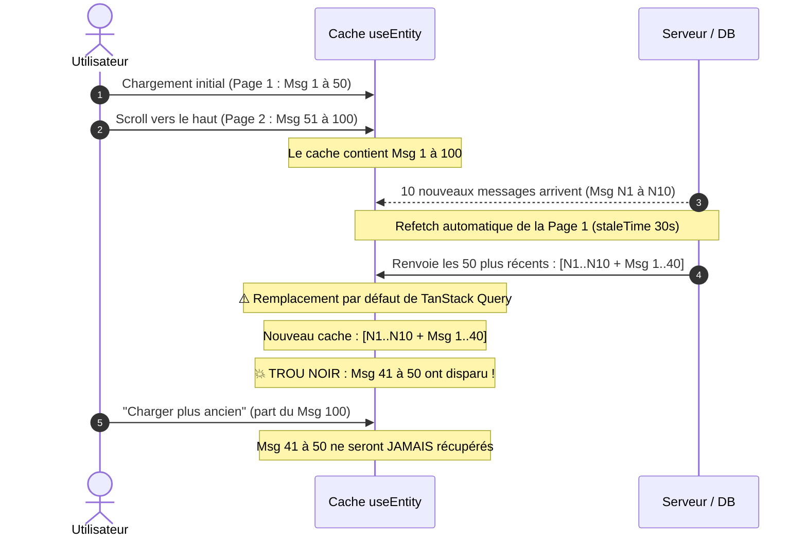

# Architecture Technique : Option B — Refetch avec Fusion dans `useEntity`

Ce document détaille l'architecture et l'implémentation technique de l'**Option B** pour résoudre le problème de **dérive de la première page** (*Pagination Drift*) lors de la pagination d'un flux de chat temps réel.
il s agit d une suggestion et non d un plan actee 
---

## 1. Définition du Problème : La Dérive de la Première Page

### Le Mécanisme de Rupture
Dans une application de messagerie temps réel, la première page est initialisée avec les $N$ messages les plus récents (ex. 50). Au fil de la navigation, l'utilisateur remonte dans le temps en chargeant des pages antérieures.



### Pourquoi le remplacement par défaut de TanStack Query échoue
Par défaut, `useQuery` considère que le retour de `queryFn` représente **l'intégralité** de la ressource identifiée par la `queryKey`. Lorsqu'un refetch se produit :
1. TanStack Query écrase la valeur en cache par les 50 messages reçus du serveur.
2. Les messages `41` à `50` (qui sont sortis de la fenêtre des 50 plus récents du serveur, mais qui sont plus récents que la page 2) sont **définitivement expulsés** du cache client.
3. Un "trou" d'historique se crée au milieu de la conversation.

---

## 2. Anatomie de `useEntity` et Potentiel de Fusion

Examinons [src/hooks/entity/useEntity.ts](file:///c:/PROJECTS/PROJECT/PRODUCTIONS/attendancy/apps/web/src/hooks/entity/useEntity.ts) :

### Ce qui existe déjà dans le fichier
`useEntity.ts` contient déjà, à la ligne 219, une fonction de fusion par identifiant :

```ts
// useEntity.ts:219
function mergeItemsById<T extends { id: string }>(oldItems: T[], newItems: T[]): T[] {
  const result = [...oldItems];

  newItems.forEach(newItem => {
    const index = result.findIndex(item => item.id === newItem.id);
    if (index >= 0) {
      result[index] = newItem; // Mise à jour de l'existant
    } else {
      result.push(newItem);    // Insertion du nouveau
    }
  });

  return result;
}
```

Cette fonction est actuellement exploitée par `refetchWithParams`, mais **pas lors d'un refetch standard de `useQuery`**.

---

## 3. Implémentation Technique de l'Option B dans `useEntity`

### A. Extension de l'interface `UseEntityOptions`

Pour garantir une compatibilité ascendante stricte avec toutes les autres entités du projet (classes, sessions, utilisateurs), le comportement de fusion doit être activable à la demande via une option dédiée :

```ts
export interface UseEntityOptions<T> {
  entityName: string;
  fetchFn?: EntityFetchFn<T>;
  transformFn?: (items: T[]) => any;
  suspense?: boolean;
  enabled?: boolean;
  initialParams?: EntityParams;
  staleTime?: number;
  revalidateMode?: "patch" | "invalidate";
  /**
   * Si true, un refetch en tâche de fond fusionne les éléments frais reçus
   * avec les éléments déjà présents en cache au lieu de les écraser.
   * Indispensable pour les flux cumulatifs (ex. chat avec historique chargé).
   * @default false
   */
  mergeOnRefetch?: boolean;
}
```

### B. Adaptation de `queryFn` dans `useEntity.ts`

Dans l'appel `useQuery` de [useEntity.ts (ligne 96)](file:///c:/PROJECTS/PROJECT/PRODUCTIONS/attendancy/apps/web/src/hooks/entity/useEntity.ts#L96-L107), on intercepte le retour pour appliquer la fusion si `mergeOnRefetch` est actif :

```ts
const {
  data,
  isLoading,
  isFetching,
  error,
  isError,
  isSuccess,
  refetch,
} = useQuery<T[], Error, any>({
  queryKey,
  queryFn: async () => {
    if (!fetchFn) return [] as T[];

    // 1. Récupération des données fraîches du serveur (les 50 plus récents)
    const freshItems = await fetchFn(initialParams);

    // 2. Si le mode fusion n'est pas activé, comportement standard (remplacement)
    if (!mergeOnRefetch) {
      return freshItems;
    }

    // 3. Récupération de l'état actuel du cache pour cette queryKey
    const currentCache = queryClient.getQueryData<any>(queryKey);
    const existingItems: T[] = Array.isArray(currentCache)
      ? currentCache
      : currentCache?.items || [];

    // 4. Au tout premier chargement, aucun élément existant -> retour direct
    if (existingItems.length === 0) {
      return freshItems;
    }

    // 5. Fusion non-destructive :
    //    - Met à jour les messages déjà connus (ex: statuts, modifications)
    //    - Ajoute les messages récents arrivés sur le serveur
    //    - PRÉSERVE l'historique antérieur déjà chargé par l'utilisateur
    return mergeItemsById(existingItems, freshItems);
  },
  staleTime,
  refetchOnWindowFocus: false,
  enabled: queryEnabled,
  ...(suspense ? { suspense: true } : {}),
  select: transformFn || itemsToById,
});
```

---

## 4. Cohérence avec `applyPayload` et les Mutations

Comment cette fusion interagit-elle avec le cycle de vie CRUD (`create`, `update`, `delete`) ?

### 1. `applyPayload("INSERT")`
Quand l'expéditeur envoie un message, `applyPayload` insère l'entrée dans le cache local.
- **Lors du prochain refetch :** Si le message est présent dans les 50 du serveur, `mergeItemsById` l'écrase avec la version serveur (source de vérité). S'il n'y est pas encore (ou déjà repoussé), il reste dans `existingItems`. **Aucune disparition de message.**

### 2. `applyPayload("UPDATE")`
Si un message est modifié localement, `applyPayload` met à jour l'entrée en cache. Le refetch réapplique la version validée par le serveur.

### 3. `applyPayload("DELETE")`
Le projet utilise des **soft-deletes** (`deletedAt DateTime?`).
- Un message supprimé reste présent dans la base de données avec `deletedAt != null`.
- `applyPayload("DELETE")` retire le message du cache.
- Lors du refetch, le serveur filtre `where: { deletedAt: null }`. Le message supprimé n'étant pas dans `freshItems`, et ayant déjà été retiré de `existingItems` par `applyPayload`, il ne réapparaît jamais.

---

## 5. Intégration du Chargement d'Historique (`getOlderMessages`)

Pour alimenter ce cache unifié avec l'historique plus ancien, voici le schéma d'intégration :

### A. La Requête avec Curseur Composite dans `message.queries.ts`

```ts
export const MESSAGES_PAGE_SIZE = 50;

export type MessageCursor = {
  createdAt: Date;
  id: string;
};

export async function getOlderMessages(
  channelId: string,
  orgId: string,
  before: MessageCursor,
  limit = MESSAGES_PAGE_SIZE,
) {
  'use cache';
  cacheTag(CACHE.MESSAGE(orgId, channelId));
  cacheLife('seconds');

  const rows = await prisma.message.findMany({
    where: {
      channelId,
      deletedAt: null,
      channel: { orgId },
      OR: [
        { createdAt: { lt: before.createdAt } },
        { createdAt: before.createdAt, id: { lt: before.id } },
      ],
    },
    select: messageSelect,
    orderBy: [{ createdAt: 'desc' }, { id: 'desc' }],
    take: limit + 1, // Détection hasMore sans count(*)
  });

  return {
    items: rows.slice(0, limit).reverse(), // Ordre chronologique croissant
    hasMore: rows.length > limit,
  };
}
```

### B. Validation de la Server Action dans `message.actions.ts`

```ts
import * as v from 'valibot';

export const olderMessagesSchema = v.object({
  channelId: v.pipe(v.string(), v.uuid('ID de canal invalide')),
  before: v.object({
    createdAt: v.pipe(
      v.string(),
      v.isoTimestamp('Date ISO invalide'),
      v.transform((s) => new Date(s)),
    ),
    id: v.pipe(v.string(), v.uuid('ID de curseur invalide')),
  }),
  limit: v.optional(v.pipe(v.number(), v.minValue(1), v.maxValue(100)), MESSAGES_PAGE_SIZE),
});
```

### C. Injection de l'Historique dans le Cache Client (`useChat.ts`)

Quand l'utilisateur clique sur *"Charger plus ancien"* ou atteint le haut du scroll :

```ts
const loadOlderMessages = useCallback(async () => {
  if (!hasMore || isLoadingOlder) return;

  // Le curseur est déduit du message le plus ancien actuellement en mémoire
  const oldestMessage = messages[0];
  if (!oldestMessage) return;

  setIsLoadingOlder(true);
  try {
    const res = await getOlderMessagesAction({
      channelId,
      before: {
        createdAt: oldestMessage.createdAt,
        id: oldestMessage.id,
      },
    });

    if (res.data) {
      const { items: olderItems, hasMore: moreAvailable } = res.data;
      setHasMore(moreAvailable);

      // Injection directe dans le cache React Query sous la clé ['messages', { channelId }]
      queryClient.setQueryData<any>(['messages', { channelId }], (oldCache: any) => {
        const currentItems = Array.isArray(oldCache) ? oldCache : oldCache?.items || [];
        // Concaténation : les messages anciens précèdent les messages courants
        const combined = mergeItemsById(olderItems, currentItems);
        return Array.isArray(oldCache) ? combined : { ...oldCache, items: combined };
      });
    }
  } finally {
    setIsLoadingOlder(false);
  }
}, [channelId, messages, hasMore, isLoadingOlder, queryClient]);
```

---

## 6. Analyse des Risques et Stratégie de Déchargement

| Risque potentiel | Solution architecturale |
| :--- | :--- |
| **Fuite mémoire si l'utilisateur charge 5 000 messages** | Le cache est indexé sur `['messages', { channelId }]`. Dès que l'utilisateur quitte le canal ou démonte le composant, les données sont collectées par le garbage collector de React Query (selon `gcTime`). |
| **Effet de bord sur les autres entités (`users`, `classes`)** | `mergeOnRefetch` est à `false` par défaut. Seul `useMessages` passe `mergeOnRefetch: true`. |
| **Messages désordonnés** | Dans `useChat`, les messages sont triés par `a.createdAt.localeCompare(b.createdAt)`. Même si `mergeItemsById` insère à la fin, l'affichage UI reste strictement chronologique. |
| **Trou d'historique lors d'un refetch** | **Éliminé**. Le cache conserve les messages intermédiaires et n'écrase que ceux qui ont été retournés par le serveur. |

---

## 7. Synthèse

L'Option B apporte la robustesse d'un infinite-scroll sans imposer une refonte structurelle du moteur `useEntity` :
1. **Zéro régression** grâce au flag optionnel `mergeOnRefetch: true`.
2. **Réutilisation** de `mergeItemsById` déjà écrit et testé.
3. **Pérennité de l'historique** remonté même en cas de reconnexion ou de refetch périodique.
