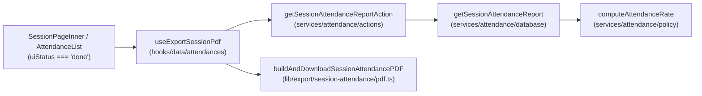

# Feature : Export PDF du rapport de présence en fin de séance (Teacher)

## 1. Contexte et objectif métier

Lorsqu'un enseignant termine sa séance depuis son espace ([`SessionPageInner.tsx`](../../apps/web/src/components/session/section/SessionPageInner.tsx)), le clic sur **« Clôturer »** déclenche [`completeSessionAction`](../../apps/web/src/services/session/actions/session.mutations.ts) → [`finalizeSession`](../../apps/web/src/services/session/database/session.mutations.ts) dans une transaction atomique :

1. [`endSession(scheduleId, tx)`](../../apps/web/src/services/session/database/session.mutations.ts) passe `Session.status` et `Schedule.status` à `"COMPLETED"`, fige `checkOut` et calcule `durationMinutes`.
2. [`markScheduleAbsences(scheduleId, tx)`](../../apps/web/src/services/attendance/database/attendance.mutations.ts) convertit les `PENDING` non validés en `ABSENT` et crée une ligne `ABSENT` pour tous les étudiants attendus n'ayant pas scanné.

**Conséquence clé (cf. [`services/attendance/policy.ts`](../../apps/web/src/services/attendance/policy.ts)) :**
Dès l'instant où la séance est clôturée (`COMPLETED`), **100 % des étudiants attendus (classe ou groupe) possèdent une ligne `Attendance` définitive** (`PRESENT`, `LATE`, `ABSENT` ou `EXCUSED`). Il n'y a plus ni `PENDING` ni absent implicite.

L'objectif de cette feature est de permettre à l'enseignant d'**exporter immédiatement la feuille d'émargement officielle de la séance au format PDF** dès que la séance est terminée.

---

## 2. Architecture et choix techniques



### Décisions d'architecture (respect des invariants [`CLAUDE.md`](../../CLAUDE.md))

1. **Propriété des modèles ([`SERVICE_CONTEXT.md`](../../apps/web/src/services/SERVICE_CONTEXT.md))** :
   - La requête d'agrégation de la feuille de présence vit dans [`apps/web/src/services/attendance/database/attendance.queries.ts`](../../apps/web/src/services/attendance/database/attendance.queries.ts) et son action dans [`apps/web/src/services/attendance/actions/attendance.queries.ts`](../../apps/web/src/services/attendance/actions/attendance.queries.ts).
2. **Sécurité & Multi-tenant strict** :
   - `orgId` est extrait exclusivement du token serveur via `authAccess({ requiredRole: ["TEACHER", "DIRECTION"] })`.
   - Si l'appelant a le rôle `TEACHER`, l'action vérifie que `schedule.teacherId === auth.data.user.organization?.teacherId` (un enseignant ne peut exporter que ses propres séances).
   - L'export exige que la séance soit clôturée (`session.status === "COMPLETED"`), garantissant un rapport figé et complet.
3. **Calcul du taux unifié** :
   - Le récapitulatif du PDF utilise `computeAttendanceRate` de [`apps/web/src/services/attendance/policy.ts`](../../apps/web/src/services/attendance/policy.ts) (`(PRESENT + LATE) / (PRESENT + LATE + ABSENT + EXCUSED)`).
4. **Rendu PDF client-side en import dynamique (`jspdf` + `jspdf-autotable`)** :
   - Les dépendances `jspdf` (`^4.2.1`) et `jspdf-autotable` (`^5.0.8`) sont déjà installées dans [`apps/web/package.json`](../../apps/web/package.json) et utilisées par [`apps/web/src/lib/export/programs/pdf/index.ts`](../../apps/web/src/lib/export/programs/pdf/index.ts).
   - Le chargement dynamique (`await Promise.all([import("jspdf"), import("jspdf-autotable")])`) n'alourdit pas le bundle initial mobile/desktop de la page de session.
5. **Pas d'appel direct d'action depuis un composant client** :
   - L'action serveur est encapsulée dans le hook [`useExportSessionPdf`](../../apps/web/src/hooks/data/attendances/use-export-session-pdf.ts).

---

## 3. Contenu du document PDF (Format A4 Portrait)

| Zone du PDF | Élément affiché | Source de la donnée (`GetSessionAttendanceReportDto`) | Exemple de rendu |
|---|---|---|---|
| **1. En-tête** | Logo de l'établissement | `organization.logo` (optionnel) | Image 14×14 mm à gauche |
| | Nom de l'organisation | `organization.name` | `UNIVERSITÉ DE LOMÉ` |
| | Titre du document | Constante statique | `FEUILLE D'ÉMARGEMENT — RAPPORT DE SÉANCE` |
| **2. Cartouche séance** | Cours (code UE + nom + type) | `schedule.courseCode`, `schedule.courseName`, `schedule.scheduleType` | `INF-301 — Base de données (CM)` |
| | Classe / Groupe | `schedule.className`, `schedule.groupName` | `L3 Génie Logiciel · Groupe A` *(ou `Classe entière`)* |
| | Salle | `schedule.roomName` | `Amphi B` |
| | Enseignant | `schedule.teacher.firstName`, `schedule.teacher.lastName` | `Jean Dupont` |
| | Date de la séance | `schedule.startTime` | `dimanche 8 novembre 2026` |
| | Créneau prévu | `schedule.startTime` – `schedule.endTime` | `08:00 – 10:00` |
| | Pointage effectif du prof | `session.checkIn`, `session.checkOut`, `session.durationMinutes` | `08:02 → 09:58 (116 min)` |
| **3. Bandeau synthèse** | Inscrits attendus | `summary.total` (`computeAttendanceRate`) | `Inscrits : 36` |
| | Présents | `summary.present` (`PRESENT`) | `Présents : 28` |
| | Retards | `summary.late` (`LATE`) | `Retards : 3` |
| | Absents | `summary.absent` (`ABSENT`) | `Absents : 4` |
| | Excusés | `summary.excused` (`EXCUSED`) | `Excusés : 1` |
| | Taux de présence | `summary.rate` (`(PRESENT + LATE) / total`) | `Taux de présence : 86 %` |
| **4. Tableau nominatif** | `N°` | Index de ligne (`1..N`) | `1` |
| *(trié par Nom, Prénom)* | `Nom et Prénom` | `student.lastName`, `student.firstName` | `KOFFI Marc` |
| | `Email` | `student.email` | `marc.koffi@ecole.tg` |
| | `Statut` | `attendances[].status` | `Présent` / `En retard` / `Absent` / `Excusé` |
| | `Heure scan` | `attendances[].recordedAt` (si `PRESENT` ou `LATE`) | `08:07` *(ou `—` si absent)* |
| | `Observation` | `attendances[].notes` | `Justificatif médical` *(ou vide)* |
| **5. Validation** | Horodatage d'édition | Date/heure courante à l'export | `Rapport généré le 08/11/2026 à 10:01` |
| | Cadre de signature | Encadré 65×22 mm | `Signature de l'enseignant : [          ]` |
| **6. Pied de page** | Rappel contexte | `organization.name`, `schedule.courseName`, `schedule.className` | `Université de Lomé · Base de données (L3 GL)` |
| | Pagination | Numéro de page / total | `Page 1 / 2` |

---

## 4. Implémentation détaillée par couche

### Étape 1 — Requête Prisma dans `services/attendance/database/attendance.queries.ts`

Fichier : [`apps/web/src/services/attendance/database/attendance.queries.ts`](../../apps/web/src/services/attendance/database/attendance.queries.ts)

```ts
// À ajouter dans apps/web/src/services/attendance/database/attendance.queries.ts
import { computeAttendanceRate, type AttendanceCounts } from "../policy";

/**
 * Données complètes du rapport de présence d'une séance clôturée (pour export PDF).
 * Scopé par `orgId`. Retourne `null` si la séance n'existe pas dans l'org.
 */
export async function getSessionAttendanceReport(
  scheduleId: string,
  orgId: string,
) {
  const schedule = await prisma.schedule.findFirst({
    where: {
      id: scheduleId,
      orgId,
      deletedAt: null,
    },
    select: {
      id: true,
      teacherId: true,
      startTime: true,
      endTime: true,
      scheduleType: true,
      status: true,
      notes: true,
      organization: {
        select: {
          name: true,
          logo: true,
          details: true,
        },
      },
      course: {
        select: {
          name: true,
          ueCourse: { select: { code: true } },
        },
      },
      room: {
        select: { name: true },
      },
      class: {
        select: {
          name: true,
          level: true,
        },
      },
      group: {
        select: { name: true },
      },
      teacher: {
        select: {
          id: true,
          user: {
            select: {
              firstName: true,
              lastName: true,
              email: true,
            },
          },
        },
      },
      session: {
        select: {
          id: true,
          status: true,
          checkIn: true,
          checkOut: true,
          durationMinutes: true,
          isLate: true,
        },
      },
      attendances: {
        select: {
          id: true,
          status: true,
          recordedAt: true,
          notes: true,
          student: {
            select: {
              id: true,
              user: {
                select: {
                  firstName: true,
                  lastName: true,
                  email: true,
                },
              },
            },
          },
        },
        orderBy: [
          { student: { user: { lastName: "asc" } } },
          { student: { user: { firstName: "asc" } } },
        ],
      },
    },
  });

  if (!schedule) return null;

  const counts: AttendanceCounts = {};
  for (const att of schedule.attendances) {
    counts[att.status] = (counts[att.status] ?? 0) + 1;
  }

  const summary = computeAttendanceRate(counts);

  return {
    schedule: {
      id: schedule.id,
      teacherId: schedule.teacherId,
      startTime: schedule.startTime,
      endTime: schedule.endTime,
      scheduleType: schedule.scheduleType,
      status: schedule.status,
      notes: schedule.notes,
      courseName: schedule.course.name,
      courseCode: schedule.course.ueCourse?.code ?? null,
      roomName: schedule.room.name,
      className: schedule.class.name,
      classLevel: schedule.class.level,
      groupName: schedule.group?.name ?? null,
      teacher: {
        firstName: schedule.teacher.user.firstName,
        lastName: schedule.teacher.user.lastName,
        email: schedule.teacher.user.email,
      },
    },
    organization: {
      name: schedule.organization.name,
      logo: schedule.organization.logo,
      details: schedule.organization.details,
    },
    session: schedule.session,
    summary: {
      total: summary.total,
      attended: summary.attended,
      rate: summary.rate,
      present: counts.PRESENT ?? 0,
      late: counts.LATE ?? 0,
      absent: counts.ABSENT ?? 0,
      excused: counts.EXCUSED ?? 0,
    },
    attendances: schedule.attendances.map((a) => ({
      id: a.id,
      status: a.status,
      recordedAt: a.recordedAt,
      notes: a.notes,
      student: {
        id: a.student.id,
        firstName: a.student.user.firstName,
        lastName: a.student.user.lastName,
        email: a.student.user.email,
      },
    })),
  };
}
```

---

### Étape 2 — Validation Valibot & Server Action dans `services/attendance/`

#### 2.1 Validation (`apps/web/src/services/attendance/validation.ts`)

```ts
// À ajouter dans apps/web/src/services/attendance/validation.ts
import * as v from "valibot";

export const getSessionAttendanceReportSchema = v.object({
  scheduleId: v.pipe(v.string(), v.uuid("ID de séance invalide")),
});

export type GetSessionAttendanceReportInput = v.InferInput<
  typeof getSessionAttendanceReportSchema
>;
```

#### 2.2 Server Action (`apps/web/src/services/attendance/actions/attendance.queries.ts`)

Fichier : [`apps/web/src/services/attendance/actions/attendance.queries.ts`](../../apps/web/src/services/attendance/actions/attendance.queries.ts)

```ts
// À ajouter dans apps/web/src/services/attendance/actions/attendance.queries.ts
import * as v from "valibot";
import { getSessionAttendanceReport } from "../database";
import {
  getSessionAttendanceReportSchema,
  type GetSessionAttendanceReportInput,
} from "../validation";

/**
 * Récupère les données du rapport de présence d'une séance clôturée (export PDF).
 * Autorisé pour TEACHER (propriétaire de la séance) et DIRECTION / ADMIN.
 */
export async function getSessionAttendanceReportAction(
  input: GetSessionAttendanceReportInput,
) {
  try {
    const auth = await authAccess({ requiredRole: ["TEACHER", "DIRECTION", "ADMIN"] });
    if (!auth.data) return { error: auth.error };
    const { orgId, user } = auth.data;

    const parsed = v.safeParse(getSessionAttendanceReportSchema, input);
    if (!parsed.success) {
      return { error: parsed.issues[0]?.message ?? "Paramètres invalides" };
    }

    const report = await getSessionAttendanceReport(parsed.output.scheduleId, orgId);
    if (!report) {
      return { error: "Séance introuvable" };
    }

    // Garde propriétaire si l'appelant est un enseignant
    if (
      user.organization?.role === "TEACHER" &&
      user.organization.teacherId !== report.schedule.teacherId
    ) {
      return { error: "Vous n'êtes pas l'enseignant responsable de cette séance" };
    }

    if (report.session?.status !== "COMPLETED") {
      return {
        error: "La séance doit être clôturée avant de pouvoir exporter le rapport de présence",
      };
    }

    return { data: report };
  } catch (error) {
    console.error("[getSessionAttendanceReportAction]", error);
    return { error: error instanceof Error ? error.message : ERRORS.SERVER };
  }
}
```

*(Après ajout : lancer `bun run generate:types:svc -- attendance` pour générer `GetSessionAttendanceReportDto` dans [`generated.types.ts`](../../apps/web/src/services/attendance/generated.types.ts), puis `bun run generate:api:svc -- attendance`.)*

---

### Étape 3 — Générateur PDF dans `apps/web/src/lib/export/session-attendance/pdf.ts`

Nouveau fichier : `apps/web/src/lib/export/session-attendance/pdf.ts`

```ts
// apps/web/src/lib/export/session-attendance/pdf.ts
import { format } from "date-fns";
import { fr } from "date-fns/locale";
import type { GetSessionAttendanceReportDto } from "@/services/attendance";
import type { AttendanceStatus } from "@/generated/prisma/browser";
import { PDF_COLORS } from "../programs/pdf/colors";
import { loadLogoAsBase64 } from "../programs/pdf/logo";

export type SessionAttendanceReportData = NonNullable<GetSessionAttendanceReportDto>;

const PAGE_A4_PORTRAIT = {
  width: 210,
  height: 297,
  margin: 15,
} as const;

const STATUS_LABELS: Record<AttendanceStatus, string> = {
  PRESENT: "Présent",
  LATE: "En retard",
  ABSENT: "Absent",
  EXCUSED: "Excusé",
  PENDING: "En attente",
};

function sanitizeSlug(value: string): string {
  return value
    .normalize("NFD")
    .replace(/[\u0300-\u036f]/g, "")
    .toLowerCase()
    .replace(/[^a-z0-9]+/g, "-")
    .replace(/(^-|-$)/g, "");
}

function buildSessionPdfFilename(report: SessionAttendanceReportData): string {
  const dateStr = format(new Date(report.schedule.startTime), "yyyy-MM-dd");
  const courseSlug = sanitizeSlug(report.schedule.courseName || "seance");
  const targetSlug = sanitizeSlug(
    report.schedule.groupName
      ? `${report.schedule.className}-${report.schedule.groupName}`
      : report.schedule.className,
  );
  return `presence-${courseSlug}-${targetSlug}-${dateStr}.pdf`;
}

export async function buildAndDownloadSessionAttendancePDF(
  report: SessionAttendanceReportData,
): Promise<void> {
  const [{ default: jsPDF }, { default: autoTable }] = await Promise.all([
    import("jspdf"),
    import("jspdf-autotable"),
  ]);

  const doc = new jsPDF({ orientation: "portrait", unit: "mm", format: "a4" });
  const { width: PAGE_W, height: PAGE_H, margin: MARGIN } = PAGE_A4_PORTRAIT;
  const centerX = PAGE_W / 2;

  const logoData = await loadLogoAsBase64(report.organization.logo ?? undefined);

  // ── 1. En-tête de l'établissement ──
  let y = 16;
  if (logoData) {
    doc.addImage(logoData, "PNG", MARGIN, y - 4, 14, 14);
  }

  doc.setFont("helvetica", "bold");
  doc.setFontSize(13);
  doc.setTextColor(...PDF_COLORS.text);
  doc.text(report.organization.name.toUpperCase(), centerX, y, { align: "center" });

  y += 6;
  doc.setFont("helvetica", "bold");
  doc.setFontSize(11);
  doc.text("FEUILLE D'ÉMARGEMENT — RAPPORT DE SÉANCE", centerX, y, { align: "center" });

  y += 4;
  doc.setDrawColor(...PDF_COLORS.border);
  doc.setLineWidth(0.3);
  doc.line(MARGIN, y, PAGE_W - MARGIN, y);

  // ── 2. Cartouche métadonnées de la séance ──
  y += 7;
  const startAt = new Date(report.schedule.startTime);
  const endAt = new Date(report.schedule.endTime);
  const dateLabel = format(startAt, "EEEE d MMMM yyyy", { locale: fr });
  const slotLabel = `${format(startAt, "HH:mm")} – ${format(endAt, "HH:mm")}`;

  const teacherName =
    [report.schedule.teacher.firstName, report.schedule.teacher.lastName]
      .filter(Boolean)
      .join(" ") || report.schedule.teacher.email;

  const audienceLabel = report.schedule.groupName
    ? `${report.schedule.className} · Groupe ${report.schedule.groupName}`
    : `${report.schedule.className} (Classe entière)`;

  const courseTitle = report.schedule.courseCode
    ? `${report.schedule.courseCode} — ${report.schedule.courseName} (${report.schedule.scheduleType})`
    : `${report.schedule.courseName} (${report.schedule.scheduleType})`;

  const checkInLabel = report.session?.checkIn
    ? format(new Date(report.session.checkIn), "HH:mm")
    : "—";
  const checkOutLabel = report.session?.checkOut
    ? format(new Date(report.session.checkOut), "HH:mm")
    : "—";

  doc.setFontSize(9);
  doc.setFont("helvetica", "bold");
  doc.setTextColor(...PDF_COLORS.text);
  doc.text(`Cours : `, MARGIN, y);
  doc.setFont("helvetica", "normal");
  doc.text(courseTitle, MARGIN + 18, y);

  y += 5;
  doc.setFont("helvetica", "bold");
  doc.text(`Classe : `, MARGIN, y);
  doc.setFont("helvetica", "normal");
  doc.text(audienceLabel, MARGIN + 18, y);

  doc.setFont("helvetica", "bold");
  doc.text(`Salle : `, centerX + 10, y);
  doc.setFont("helvetica", "normal");
  doc.text(report.schedule.roomName, centerX + 25, y);

  y += 5;
  doc.setFont("helvetica", "bold");
  doc.text(`Enseignant : `, MARGIN, y);
  doc.setFont("helvetica", "normal");
  doc.text(teacherName, MARGIN + 24, y);

  doc.setFont("helvetica", "bold");
  doc.text(`Date : `, centerX + 10, y);
  doc.setFont("helvetica", "normal");
  doc.text(dateLabel, centerX + 25, y);

  y += 5;
  doc.setFont("helvetica", "bold");
  doc.text(`Créneau : `, MARGIN, y);
  doc.setFont("helvetica", "normal");
  doc.text(slotLabel, MARGIN + 20, y);

  doc.setFont("helvetica", "bold");
  doc.text(`Pointage prof : `, centerX + 10, y);
  doc.setFont("helvetica", "normal");
  doc.text(
    `${checkInLabel} → ${checkOutLabel} (${report.session?.durationMinutes ?? 0} min)`,
    centerX + 36,
    y,
  );

  // ── 3. Bandeau de synthèse des présences ──
  y += 7;
  doc.setFillColor(...PDF_COLORS.ueBg);
  doc.rect(MARGIN, y - 4, PAGE_W - MARGIN * 2, 9, "F");

  const { summary } = report;
  const rateText = summary.rate !== null ? `${summary.rate} %` : "—";
  const summaryLine = [
    `Inscrits : ${summary.total}`,
    `Présents : ${summary.present}`,
    `Retards : ${summary.late}`,
    `Absents : ${summary.absent}`,
    `Excusés : ${summary.excused}`,
    `Taux de présence : ${rateText}`,
  ].join("   |   ");

  doc.setFont("helvetica", "bold");
  doc.setFontSize(8.5);
  doc.setTextColor(...PDF_COLORS.text);
  doc.text(summaryLine, centerX, y + 1.5, { align: "center" });

  y += 9;

  // ── 4. Tableau nominatif des étudiants ──
  const tableBody = report.attendances.map((row, idx) => {
    const fullName =
      [row.student.lastName?.toUpperCase(), row.student.firstName]
        .filter(Boolean)
        .join(" ") || row.student.email;

    const scanTime =
      row.status === "PRESENT" || row.status === "LATE"
        ? format(new Date(row.recordedAt), "HH:mm")
        : "—";

    return [
      String(idx + 1),
      fullName,
      row.student.email,
      STATUS_LABELS[row.status] ?? row.status,
      scanTime,
      row.notes ?? "",
    ];
  });

  autoTable(doc, {
    startY: y,
    margin: { left: MARGIN, right: MARGIN },
    head: [["N°", "Nom et Prénom", "Email", "Statut", "Heure scan", "Observation"]],
    body: tableBody,
    theme: "grid",
    styles: {
      fontSize: 8,
      cellPadding: 2.2,
      lineColor: PDF_COLORS.border,
      lineWidth: 0.1,
      textColor: PDF_COLORS.text,
    },
    headStyles: {
      fillColor: PDF_COLORS.headerBg,
      textColor: PDF_COLORS.text,
      fontStyle: "bold",
    },
    alternateRowStyles: {
      fillColor: PDF_COLORS.rowAlt,
    },
    columnStyles: {
      0: { cellWidth: 10, halign: "center" },
      1: { cellWidth: 52 },
      2: { cellWidth: 52 },
      3: { cellWidth: 22, halign: "center" },
      4: { cellWidth: 20, halign: "center" },
      5: { cellWidth: "auto" },
    },
  });

  y = (doc as unknown as { lastAutoTable: { finalY: number } }).lastAutoTable.finalY + 10;

  // ── 5. Bloc Signature de l'enseignant ──
  if (y > PAGE_H - 35) {
    doc.addPage();
    y = 20;
  }

  doc.setFont("helvetica", "normal");
  doc.setFontSize(8);
  doc.setTextColor(...PDF_COLORS.muted);
  doc.text(
    `Rapport généré le ${format(new Date(), "dd/MM/yyyy à HH:mm", { locale: fr })}`,
    MARGIN,
    y + 4,
  );

  const sigBoxX = PAGE_W - MARGIN - 65;
  doc.setDrawColor(...PDF_COLORS.border);
  doc.rect(sigBoxX, y, 65, 22);
  doc.setFont("helvetica", "bold");
  doc.setTextColor(...PDF_COLORS.text);
  doc.text("Signature de l'enseignant :", sigBoxX + 3, y + 5);

  // ── 6. Pied de page sur toutes les pages ──
  const totalPages = doc.getNumberOfPages();
  for (let i = 1; i <= totalPages; i++) {
    doc.setPage(i);
    doc.setFont("helvetica", "normal");
    doc.setFontSize(7);
    doc.setTextColor(...PDF_COLORS.muted);
    doc.text(
      `${report.organization.name} · ${report.schedule.courseName} (${report.schedule.className})`,
      MARGIN,
      PAGE_H - 8,
    );
    doc.text(`Page ${i} / ${totalPages}`, PAGE_W - MARGIN, PAGE_H - 8, { align: "right" });
  }

  doc.save(buildSessionPdfFilename(report));
}
```

---

### Étape 4 — Hook client dans `apps/web/src/hooks/data/attendances/use-export-session-pdf.ts`

Nouveau fichier : `apps/web/src/hooks/data/attendances/use-export-session-pdf.ts`

```ts
// apps/web/src/hooks/data/attendances/use-export-session-pdf.ts
"use client";

import { useMutation } from "@tanstack/react-query";
import { toast } from "sonner";
import { getSessionAttendanceReportAction } from "@/services/attendance";
import { buildAndDownloadSessionAttendancePDF } from "@/lib/export/session-attendance/pdf";

export function useExportSessionPdf(scheduleId: string) {
  const mutation = useMutation({
    mutationFn: async () => {
      const result = await getSessionAttendanceReportAction({ scheduleId });
      if ("error" in result) {
        throw new Error(result.error);
      }
      await buildAndDownloadSessionAttendancePDF(result.data);
      return result.data;
    },
    onSuccess: () => {
      toast.success("Rapport de présence téléchargé en PDF.");
    },
    onError: (err: Error) => {
      toast.error(err.message || "Impossible de générer le rapport PDF.");
    },
  });

  return {
    exportPdf: mutation.mutate,
    isExporting: mutation.isPending,
  };
}
```

---

### Étape 5 — Intégration UI dans [`SessionPageInner.tsx`](../../apps/web/src/components/session/section/SessionPageInner.tsx)

Lorsqu'une séance passe à l'état terminé (`uiStatus === "done"` ou `optimisticSession?.status === "COMPLETED"`), un bouton secondaire sobre **« Exporter le rapport PDF »** s'affiche sous le bouton d'état « Session terminée ».

Fichier : [`apps/web/src/components/session/section/SessionPageInner.tsx`](../../apps/web/src/components/session/section/SessionPageInner.tsx)

```tsx
// Imports à ajouter dans SessionPageInner.tsx :
import { FileDown, Loader2 } from "lucide-react";
import { useExportSessionPdf } from "@/hooks/data/attendances/use-export-session-pdf";

// Dans le corps de SessionPageInner :
const { exportPdf, isExporting } = useExportSessionPdf(schedule.id);
const isCompleted =
  uiStatus === "done" || optimisticSession?.status === "COMPLETED";

// Sous le <Button> principal (lignes 148-166) :
<div className="flex flex-col gap-2.5">
  <Button
    size="lg"
    variant={actionBtn.variant}
    className="h-12 w-full rounded-xl"
    disabled={actionBtn.disabled}
    onClick={() => {
      if (actionBtn.action === "start") startSession();
      if (actionBtn.action === "end") endSession();
    }}
  >
    {isBusy ? (
      <span className="text-[13px]">Chargement…</span>
    ) : (
      <>
        <ActionIcon className="size-4 mr-1" />
        <span className="text-[13px] font-medium">{actionBtn.label}</span>
      </>
    )}
  </Button>

  {isCompleted && (
    <Button
      type="button"
      size="lg"
      variant="outline"
      className="h-11 w-full rounded-xl gap-2 text-[13px] font-medium"
      disabled={isExporting}
      onClick={() => exportPdf()}
    >
      {isExporting ? (
        <>
          <Loader2 className="size-4 animate-spin" />
          <span>Génération du PDF…</span>
        </>
      ) : (
        <>
          <FileDown className="size-4" />
          <span>Exporter le rapport PDF</span>
        </>
      )}
    </Button>
  )}
</div>
```

---

## 5. Vérifications post-implémentation

Conformément à [`CLAUDE.md`](../../CLAUDE.md), exécuter depuis `apps/web/` :

```bash
cd apps/web
bun run check:naming:svc -- attendance
bun run generate:types:svc -- attendance
bun run check:types:svc -- attendance
bun run generate:api:svc -- attendance
bun run api:check
bun run ts:check
```

### Cas de test à couvrir

1. **Séance clôturée (`COMPLETED`) avec mix de statuts (`PRESENT`, `LATE`, `ABSENT`, `EXCUSED`)** :
   - `getSessionAttendanceReport` retourne tous les étudiants triés par nom, les compteurs exacts et `summary.rate` conforme à `computeAttendanceRate`.
2. **Séance encore `ACTIVE` ou non démarrée (`session === null`)** :
   - `getSessionAttendanceReportAction` refuse l'export avec le message explicite `"La séance doit être clôturée avant de pouvoir exporter le rapport de présence"`.
3. **Isolation enseignant / multi-tenant** :
   - Un enseignant B de la même organisation (ou d'une autre organisation) appelant `getSessionAttendanceReportAction` sur la séance de l'enseignant A reçoit une erreur d'autorisation.
   - Un membre `DIRECTION` de la même organisation peut exporter le rapport de n'importe quelle séance clôturée de son établissement.

